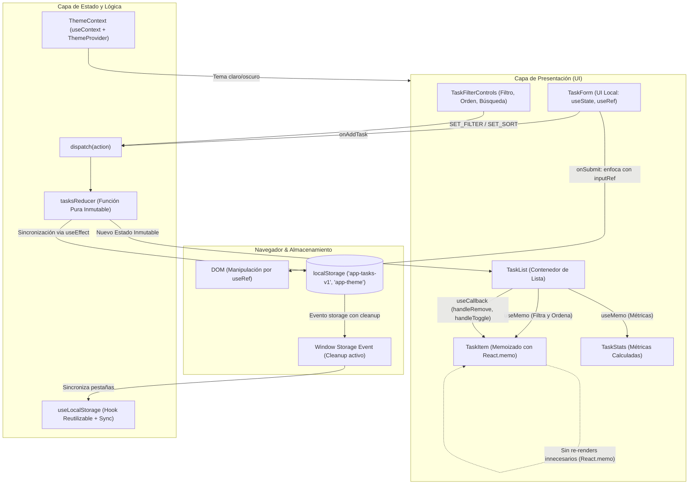

# Práctica de Laboratorio 07 (Parte 2): Dashboard de Gestión con Estado Complejo y React Hooks Avanzados

**Universidad Nacional del Centro del Perú**  
**Facultad de Ingeniería de Sistemas**  
**Asignatura:** Desarrollo de Aplicaciones Web (IS093A)  
**Tema:** `useState`, `useEffect`, `useContext`, `useRef`, `useReducer`, `useCallback`, `useMemo` y Hooks Personalizados.

---

## 1. Descripción del Proyecto

Este proyecto implementa un **Dashboard de Gestión de Tareas de Alto Rendimiento** diseñado bajo la arquitectura de componentes funcionales en React. La aplicación resuelve problemáticas reales de sincronización de estado, fugas de memoria, optimización del árbol de renderizado y desacoplamiento de la lógica de negocio mediante el uso estratégico de Hooks.

### Novedades y Componentes Visuales:
- **Gráficos reactivos en SVG y CSS:**
  - *Donut Chart* interactivo que ilustra la tasa de finalización global.
  - Gráfico de barras de distribución porcentual por categorías (Desarrollo, Diseño, Estudio, QA).
  - Matriz de balance de prioridades (Alta, Media, Baja).
- **Herramientas de Profiling integradas:**
  - Generador de lotes masivos (+15 tareas) con un clic para medir el impacto de `useMemo` y `useCallback` en React DevTools Profiler.
  - Botón de restauración de datos demo iniciales.

---

## 2. Diagrama de Flujo de Estado y Ciclo de Render

El siguiente diagrama ilustra el flujo unidireccional de datos, el despacho de acciones y el ciclo de renderizado optimizado:



---

## 3. Justificación Técnica de Cada Hook Utilizado

### ¿Por qué no usar `useState` simple para todo?

| Hook Utilizado | Propósito en el Dashboard | ¿Por qué NO usar `useState` simple? |
| :--- | :--- | :--- |
| **`useReducer`** | Manejo de la lista de tareas (`ADD`, `REMOVE`, `TOGGLE`, `SET_FILTER`, `SET_SORT`, `CLEAR_COMPLETED`). | Con `useState`, múltiples estados interdependientes (filtros, orden, array de tareas, búsqueda) provocan múltiples llamadas a `setState` dispersas por la UI, riesgo de condiciones de carrera (*race conditions*) y dificultad para mantener la inmutabilidad y probar la lógica de negocio aislada. `useReducer` centraliza la transición de estados en una función pura inmutable predecible. |
| **`useContext`** | Gestión global del tema visual (claro / oscuro). | Usar `useState` requeriría *prop drilling* (pasar `theme` y `setTheme` a través de múltiples niveles de componentes intermedios que no necesitan esa información), ensuciando los contratos de props y acoplando los componentes innecesariamente. |
| **`useEffect` con Cleanup** | Sincronización con `localStorage` y suscripción a eventos de ventana entre pestañas. | `useState` únicamente almacena memoria durante la vida útil del componente. Para efectos secundarios e interacción con APIs externas (como `localStorage` o `window.addEventListener`), es mandatorio `useEffect`. La función de limpieza (`return () => ...`) previene fugas de memoria (*memory leaks*) al desmontar o ante cambios frecuentes. |
| **`useMemo`** | Cálculo de tareas filtradas/ordenadas y estadísticas numéricas. | Si se calculase directamente en el cuerpo del componente, operaciones de ordenamiento (`.sort()`) y filtrado (`.filter()`) se ejecutarían en **cada render** (por ejemplo, cada vez que el usuario teclea en un input o cambia el tema). `useMemo` memoriza el resultado y sólo lo recalcula si sus dependencias (`tasks`, `filter`, `sort`, `searchQuery`) cambian. |
| **`useCallback`** | Estabilización referencial de los callbacks `handleRemove` y `handleToggle`. | En cada render, JavaScript crea nuevas referencias de funciones en memoria. Si se pasan como props a componentes hijos memoizados (`TaskItem` con `React.memo`), estos detectarán una referencia distinta y se re-renderizarán de todos modos. `useCallback` mantiene la misma instancia funcional entre renders. |
| **`useRef`** | Foco automático en el campo de texto y desplazamiento hacia la lista. | Modificar un `useState` para controlar el foco provocaría un re-render innecesario de la interfaz. `useRef` permite interactuar directamente con el nodo del DOM o preservar valores mutables sin disparar el ciclo de renderizado de React. |
| **Custom Hook (`useLocalStorage`)** | Persistencia y sincronización reactiva bidireccional. | Abstrae la serialización JSON, la captura de errores en navegadores con cuotas llenas o navegación privada, y la sincronización con el evento `storage` en una pieza de lógica reutilizable en cualquier proyecto. |

---

## 4. Roles Técnicos Implementados

- **Arquitecto de Estado:** Diseño del reducer inmutable en [src/hooks/useTasksReducer.js](src/hooks/useTasksReducer.js) con tipos de acción fuertemente desacoplados.
- **Ingeniero de Efectos & Contexto:** Configuración de [src/contexts/ThemeContext.jsx](src/contexts/ThemeContext.jsx) con limpieza estricta de listeners y sincronización bidireccional.
- **Optimizador de Rendimiento:** Integración de `React.memo`, `useMemo` y `useCallback` en [src/components/TaskList.jsx](src/components/TaskList.jsx) y [src/components/TaskItem.jsx](src/components/TaskItem.jsx).
- **QA & Hook Validator:** Cumplimiento de las reglas de los hooks verificado con ESLint (`react-hooks/rules-of-hooks` y `react-hooks/exhaustive-deps`) con **0 warnings y 0 errores**.

---

## 5. Guía de Validación y Pruebas

### 5.1. Verificación de Cero Advertencias en ESLint
Ejecutar en la terminal:
```bash
npm run lint
```
*Resultado esperado:* Salida limpia sin advertencias de dependencias faltantes en hooks (`react-hooks/exhaustive-deps`).

### 5.2. Validación con React DevTools Profiler
1. Iniciar la aplicación:
   ```bash
   npm run dev
   ```
2. Abrir la consola del navegador (F12) e ir a la pestaña **Profiler** de React DevTools.
3. Hacer clic en **Record** (grabar).
4. Escribir texto en el buscador o agregar una tarea.
5. Detener la grabación:
   - Observar cómo los elementos `TaskItem` memoizados no se renderizan innecesariamente gracias a `useCallback` y `React.memo`.
   - Verificar la disminución drástica de commits de renderizado en el gráfico de llamas (*Flamegraph*).

### 5.3. Validación del Cleanup en `useEffect`
1. Alternar entre las pestañas "Panel de Tareas" y "Auditoría de Hooks".
2. Abrir la consola del navegador y comprobar que no existan advertencias de actualizaciones sobre componentes desmontados o fugas de listeners en `window`.

---

## 6. Instalación y Ejecución Local

```bash
# 1. Clonar el repositorio
git clone https://github.com/ZairRaaa/Semana_7_practica_2.git

# 2. Ingresar a la carpeta
cd Semana_7_practica_2

# 3. Instalar dependencias
npm install

# 4. Iniciar servidor de desarrollo
npm run dev

# 5. Compilar para producción
npm run build
```
